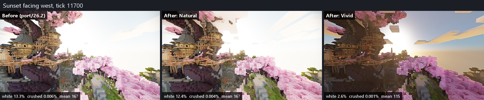
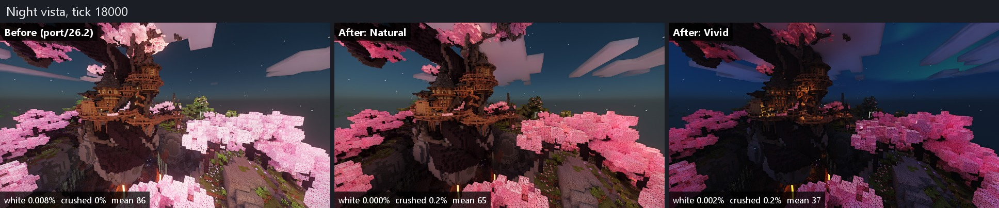
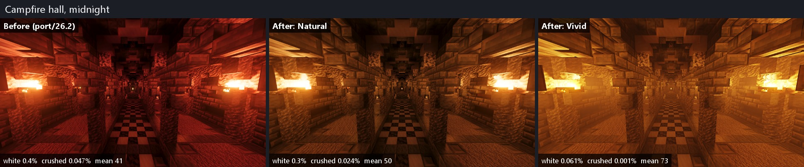
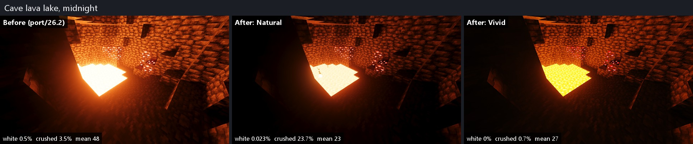
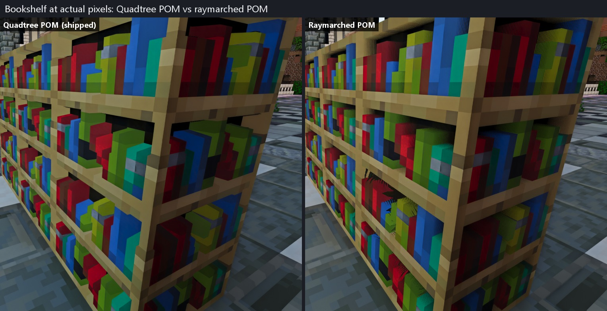
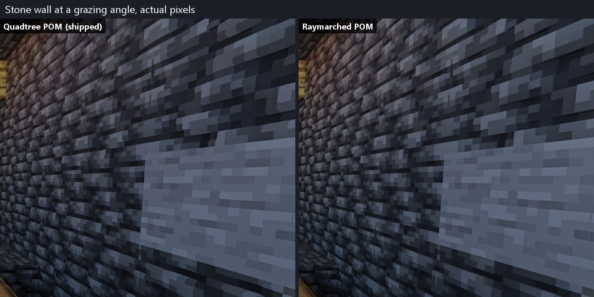
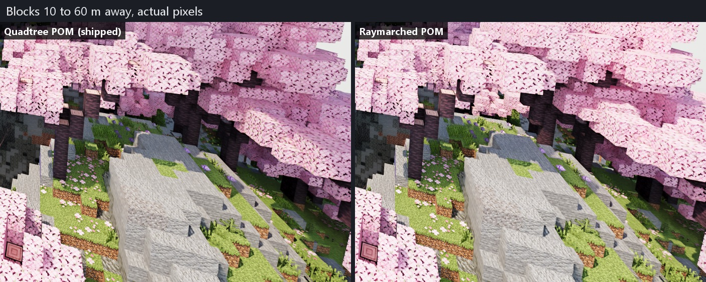
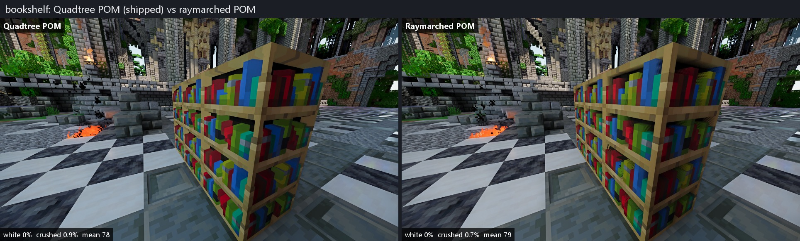

# Screenshots

Screenshots for pull request #1, kept on this branch so the images stay out of the code
branch and its squash merge. Nothing here is built or shipped.

## Style pass, 10 Nov 2026

Captured in the showcase world with SPBR 16x, render distance 16, Remix defaults and SDR
output. Figures under each panel: pixels clipped to white (every channel 250 or more),
pixels crushed to black (every channel 3 or less), and mean brightness on a 0 to 255 scale.

### Merged build: before, Natural, Vivid

Each sheet shows one pose three times: before is `port/26.2` at `6090903`, then the merged
build (`6ef25dc`) with the Natural look and with the Vivid look. Times are Minecraft ticks.

| Sheet | Pose |
|---|---|
| [v_day](style-pass/merged/v_day.jpg) | Daytime vista, tick 4000 |
| [v_sunset](style-pass/merged/v_sunset.jpg) | Sunset facing west, tick 11700 |
| [v_dusk](style-pass/merged/v_dusk.jpg) | Dusk, tick 12300 |
| [v_dawn](style-pass/merged/v_dawn.jpg) | Sunrise over the sea, tick 300 |
| [w_sunset](style-pass/merged/w_sunset.jpg) | Sunset over water, tick 11700 |
| [shore_day](style-pass/merged/shore_day.jpg) | Beach, morning |
| [x_ruins2](style-pass/merged/x_ruins2.jpg) | Forest facing the sun, tick 1500 |
| [x_ruins1](style-pass/merged/x_ruins1.jpg) | Forest ruin, tick 11700 |
| [v_night](style-pass/merged/v_night.jpg) | Night vista, tick 18000 |
| [n_aurora](style-pass/merged/n_aurora.jpg) | Night facing north, tick 18000 |
| [l_night](style-pass/merged/l_night.jpg) | Night over the sea, tick 18000 |
| [town_night](style-pass/merged/town_night.jpg) | Town from above, midnight |
| [glow_mushroom_night](style-pass/merged/glow_mushroom_night.jpg) | Mushroom houses, midnight |
| [sea_lantern_night](style-pass/merged/sea_lantern_night.jpg) | Ocean monument from above, midnight |
| [t_night](style-pass/merged/t_night.jpg) | Torch hall at night |
| [camp_night](style-pass/merged/camp_night.jpg) | Campfire hall, midnight |
| [mine_tunnel](style-pass/merged/mine_tunnel.jpg) | Torch-lit mine, midnight |
| [portal_cave](style-pass/merged/portal_cave.jpg) | Nether portal cave, midnight |
| [bench_night](style-pass/merged/bench_night.jpg) | Test room of every flame and lamp, midnight |
| [lava_lake](style-pass/merged/lava_lake.jpg) | Cave lava lake, midnight |
| [g_night](style-pass/merged/g_night.jpg) | Lava ravine, tick 18000 |

### Texture pack check: Quadtree POM against raymarched POM

The same poses with the shipped Quadtree POM and with raymarched POM, at actual pixels,
with Continuity, Entity Model Features and Entity Texture Features installed.

### Session sheets

The sheets each style session made before the merge:

- [`sessions/tone-sky/`](style-pass/sessions/tone-sky): Natural against Vivid, before the
  lights pass.
- [`sessions/lights-water/`](style-pass/sessions/lights-water): before against after in the
  Natural look. `s2_emitters_closeup_midnight.jpg` has every emitter type up close with
  clipped-pixel counts.
